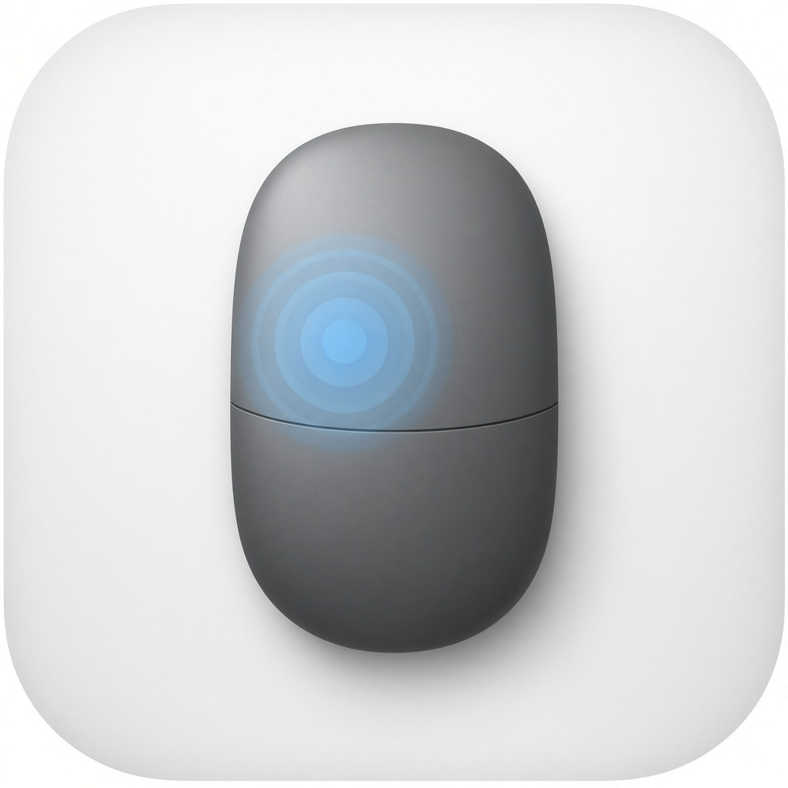

# Magic Mouse Tap

<p align="center">
  
</p>

Menu bar utility that adds **tap to click** to the Apple Magic Mouse (1 & 2).

The Magic Mouse has a multitouch surface but no system “Tap to click” setting. This app listens for short taps via Apple’s private `MultitouchSupport` framework and posts left/right mouse clicks.

## Features

- Tap the **left** half of the surface → primary click  
- Tap the **right** half → secondary (right) click  
- Double / triple tap supported  
- Toggle on/off from the menu bar  
- Reconnect after sleep / Bluetooth reconnect  

## Requirements

- macOS 13 or later  
- Apple Magic Mouse connected (Bluetooth or Lightning/USB)  
- Accessibility permission (to post click events)  

## Build & run

```bash
./build.sh
open build/MagicMouseTap.app
```

Or install permanently:

```bash
./build.sh
cp -R build/MagicMouseTap.app /Applications/
open /Applications/MagicMouseTap.app
```

Universal binary (Apple Silicon + Intel):

```bash
ARCH=universal ./build.sh
```

## Grant Accessibility

On first launch, macOS prompts for Accessibility access. If not:

1. Open **System Settings → Privacy & Security → Accessibility**
2. Enable **Magic Mouse Tap**
3. Click the menu bar mouse icon → ensure **Tap to Click** is checked

After granting permission, open the menu once so the app can start listening (no relaunch required).

## Launch at login

**System Settings → General → Login Items → +** → add `MagicMouseTap.app`.

## Notes

- Uses the undocumented `MultitouchSupport.framework` — not App Store eligible; may need updates after major macOS releases.
- Physical clicks still work; tapping is an additional input.
- Scroll and multi-finger gestures are ignored (movement / multi-lift filters).
